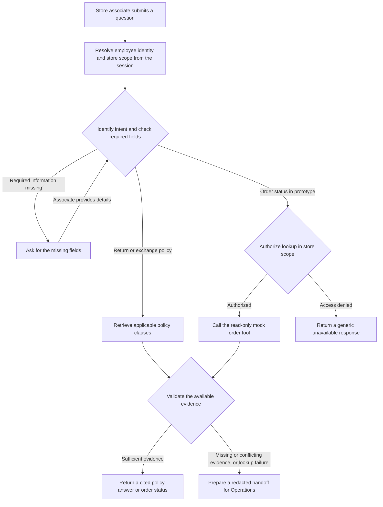

# NovaMart Store Support Assistant

Artefact take-home case study · MVP design brief

## 1. Problem and delivery scope

Store associates and shift leads need quick answers about store policies and order status while serving customers. Waiting for Operations interrupts service, and Operations repeatedly handles similar questions. The MVP aims to reduce the time it takes to resolve a request correctly and the amount of repeat work for Operations.

The five categories below are demand hypotheses. During the first one to two weeks, sample tickets, chat, phone calls, and store shifts. Include requests that associates resolve on their own, and deduplicate follow-ups about the same issue. Measure request volume by store, shift, and category. Record active handling time separately from time spent waiting for a reply. Estimate workload as frequency × active handling time, then factor in the consequences of an incorrect answer when setting priorities.

| Provisional rank | Category | Example question |
|---|---|---|
| 1 | Returns, exchanges, and refunds | Can I return an online purchase at this store? |
| 2 | Order status, pickup, and delivery exceptions | The customer is here. Is the order ready for pickup? |
| 3 | Product information and stock availability | Which nearby store has this size? |
| 4 | Pricing, promotions, and price matching | Can this coupon be combined with a member discount? |
| 5 | Checkout, payments, and point-of-sale exceptions | How should I handle this transaction while the register is offline? |

**Interview prototype.** Use a Python CLI, the OpenAI API, six synthetic policy documents, and one read-only mock order tool. Demonstrate a cited return-policy answer, an order lookup, and an Operations handoff. A single model API keeps the integration small enough to build and evaluate the core flows within the exercise.

**Initial store pilot.** Cover return and exchange policy questions and handoffs to Operations. Route refund approvals and transaction changes through existing processes. Validate business demand, order access rules, and data handling before connecting the live order system.

## 2. MVP architecture and ownership

The pilot web app displays a dynamic form with only the missing fields that could change the answer, up to four per turn. For example, for an online purchase return, the app derives the store from the session and asks for the purchase date or product category only when it affects policy eligibility. If the additional information still leaves the answer unresolved, offer an Operations handoff.

The production starting point is a hosted model behind a lightweight application. AI Engineering and Security assess NovaMart's existing enterprise platform and the custom application against the same criteria: store-level authorization, read-only order integration, auditability, and vendor data handling. Use managed capabilities where they pass those checks, and enforce the remaining controls in the application. The Engineering lead owns delivery, and the Operations lead owns the pilot outcome.

## 3. Module responsibilities and acceptance criteria

| Module | Proposed owner | Responsibility |
|---|---|---|
| Store entry point and identity | Store Applications | Accept the question and derive employee identity and authorized store scope from the verified session. Use synthetic identities in the prototype. |
| Assistant orchestration | AI Engineering | Identify intent, validate tool arguments, collect required fields, and re-evaluate the request after clarification. |
| Policy retrieval | AI Engineering and Operations | Retrieve approved clauses for the relevant scope and effective date. Operations maintains authoritative versions, defines whether purchase or request date governs, and sets precedence for regional and channel exceptions. Route unresolved version conflicts to Operations. |
| Order lookup | Commerce Integrations | Query only within the server-authorized scope and return the permitted status and last-updated timestamp. Distinguish upstream failure from an empty result internally. |
| Answer and handoff | AI Engineering and Operations | Check each policy claim against the applicable clause. Generate a copyable, redacted summary in the prototype. In the pilot, use the existing Operations queue and record the handoff reason, pickup time, and outcome. |
| Evaluation and monitoring | AI Engineering and Platform | Maintain fixed acceptance cases and capture outcomes, latency, and handoff reasons. Operations reviews policy applicability and answer quality. |

Before implementation, tie each acceptance case to a synthetic policy clause and version or to the expected order-tool arguments and result. Hold back paraphrases and boundary cases for final acceptance. Report grounded correct answers, appropriate handoffs, and unsupported assertions separately. Manually verify that cited clauses support each conclusion.

| Test scenario | Expected behavior |
|---|---|
| Online purchase eligible for return | Cite the applicable clause and version, and explain the relevant conditions. |
| Missing purchase date that affects eligibility | Ask for the missing field and re-evaluate after it is supplied. |
| Expired clause or conflicting policy versions | Cite the effective version when precedence resolves the conflict. Escalate unresolved conflicts. |
| Order lookup within the associate's store scope | Call the read-only tool with the expected arguments and report the returned status. |
| Attempt to access another store's order or infer whether it exists | Block unauthorized access server-side and return a generic unavailable response that conceals order existence. |
| Order-tool timeout or missing policy evidence | Say that the result could not be verified and generate a redacted handoff with the reason and next step. |

## 4. Security review

Associate input may contain customer names, contact details, payment data, or order identifiers that can be linked to a customer. Redact sensitive fields before model calls and handoffs. Replace order IDs with opaque references scoped to the request. The live order interface uses a least-privilege, read-only service identity and constrains each lookup to the store scope derived server-side from the employee session. Allowlist tool calls and response fields, and treat policy text and tool output as untrusted data. Keep only essential audit metadata in logs. Security signs off on access controls, log retention, and vendor data handling before live data is connected. Any acceptance case that exposes unauthorized data blocks the pilot.

## 5. Performance and capacity

Assume 20 requests per store per day over a 10-hour busy window. At 1,000 stores, that is approximately 20,000 requests per day, 0.56 requests per second on average during that window, and roughly 6 requests per second at a modeled 10× peak. For initial load tests, assume up to two model calls and one order lookup per turn. Check model request and token quotas separately from order-system throughput. Recalculate capacity with observed intent mix, peak traffic, and clarification turns after the pilot.

Test representative mixed traffic, promotion spikes, model rate limiting, and a slow order service. Evaluate the provisional p95 target of 5 seconds by route alongside timeout, correct completion, and handoff rates. Cache policy retrieval by scope and document version. Set concurrency limits and request deadlines, and offer an Operations handoff when an upstream dependency times out.

## 6. Production monitoring and response

- **Reliability.** Platform tracks request volume, p95 latency, errors, and handoff reasons by route. Page the on-call engineer if p95 stays above the provisional 5-second target for 15 minutes at sufficient volume. During low-volume pilots, run synthetic probes and watch for consecutive failures. Trace issues across model, retrieval, and tool calls, and route the affected workflow to Operations when necessary.
- **Answer quality.** Operations and AI Engineering review a daily pilot sample stratified by intent and outcome, including direct answers and handoffs. Check each case against the policy version or order result available at the time. Alert on policy sync failures and investigate changes in handoff rates against the pilot baseline.
- **Security.** Security investigates access anomalies using audit metadata. Confirmed unauthorized disclosure immediately pauses the pilot and triggers incident response.

## 7. Deployment and pilot

1. **Staging.** Run fixed acceptance cases in CI. Deploy to staging with test identities and data, then exercise alerting, handoff, and rollback.
2. **Limited pilot.** After Operations and Security sign off, enable the pilot through a store-level flag. Select comparison stores with similar traffic and channel mix that keep the existing workflow during the same period. Compare each group's change from its own baseline.
3. **Phased expansion.** Use the share of eligible requests resolved correctly within the agreed time as the primary metric. Deduplicate the denominator and include requests handled without the assistant or handed off. Track requests requiring human handling per 100 eligible requests as a secondary metric. Agree on the minimum improvement and pause criteria before launch. Review quality, latency, errors, and sample size before expanding. Report observed differences and their uncertainty when the pilot includes few stores.

## 8. Open questions

- What are the actual request volumes, channel mix, and handling-time baselines by store?
- Who resolves policy conflicts, which date governs each rule, and how quickly must updates reach stores?
- Which roles can look up orders across stores or channels, and which fields can the order system return?
- Which hosting, audit, and data retention arrangements has NovaMart approved? Who is on call, and who picks up handoffs?
- What resolution window, minimum improvement, and stopping conditions will Operations accept?
