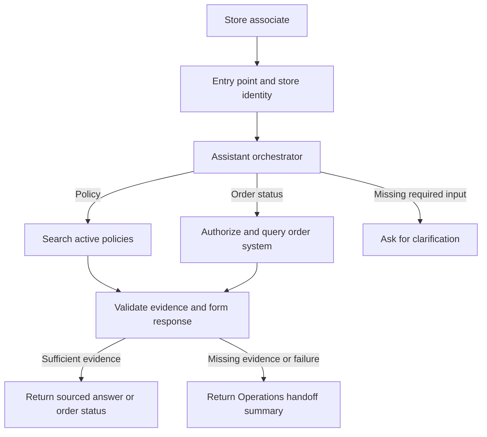

# NovaMart Store Support Assistant

Artefact case study · MVP design brief

## 1. Problem, users, and frequency

Store associates and shift leads repeatedly ask Operations about returns and order status. Waiting for an answer interrupts customer service. Operations staff answer repeat questions and handle exceptions. NovaMart’s actual volume is unknown. Before the pilot, use two weeks of tickets and a sample of informal requests to estimate questions per store per day, topic mix, peak hours, resolution time, and the share that needs manual handling.

## 2. MVP architecture and ownership

Build a Python CLI with the OpenAI API, six synthetic policy documents, and one read-only mock order tool. Demonstrate a sourced policy answer, a mock order lookup, and a handoff when evidence is missing. For production, start with a hosted model and a lightweight application that controls authorization and tool execution. Reassess an enterprise-managed option against the same requirements for access, integration, and audit.

The engineering lead owns delivery. The Operations lead owns the pilot outcome. The team names below describe proposed responsibilities.

## 3. Module responsibilities

| Module | Owner | What it does |
|---|---|---|
| Entry point and identity | Store Apps | Accepts the question and derives authorized store scope from a verified session. The CLI uses synthetic store identities. |
| Orchestration | AI Engineering | Routes to policy, order lookup, or both. Validates tool arguments and asks for clarification when required inputs are missing. |
| Policy retrieval | AI Engineering + Operations | Retrieves applicable clauses by scope and effective date. Operations owns publication and version precedence. Conflicting or missing clauses trigger handoff. |
| Order lookup | Commerce Integrations | Queries only orders within the employee’s authorized scope. Returns status and freshness, and reports unavailable results or timeouts. |
| Answer and handoff | AI Engineering + Operations | Links policy claims to retrieved clauses and reports order facts from the tool. Packages unresolved requests with the question, checks performed, and next step. |
| Evaluation and telemetry | AI Engineering + Platform | Runs regression cases and tracks latency, tool errors, sampled answer correctness, and handoff rate by request type. |

## 4. Security review

Free text can contain customer names, contact details, or payment data. Order IDs can identify customers when linked to other records. Redact sensitive fields before model calls and handoffs, and use opaque references for order IDs. Keep raw prompts and order payloads out of logs. Use a scoped read-only service identity and enforce access on every lookup. Treat retrieved text and tool output as data, and allowlist tool calls and returned fields. Audit access decisions with restricted, time-limited logs. Security signs off on retention, provider data handling, and access controls before live data is connected.

## 5. Performance review and 1,000-store scale

For sizing only, assume 20 requests per store per day across a 10-hour busy window. At 1,000 stores that is 20,000 requests per day, about 0.56 requests per second on average and roughly 6 per second at a modeled 10× peak. Model calls and order-system latency are the first bottlenecks to test. Use a provisional p95 target of 5 seconds per request type. Load-test a mixed traffic profile at the modeled peak and check provider and order-system quotas. Scale stateless workers as needed, cache policy retrieval by scope and document version, and apply deadlines, bounded concurrency, and a handoff when an upstream dependency times out.

## 6. Deployment and rollout

1. Run CI with synthetic fixtures for cited answers, missing or stale evidence, order timeouts, and cross-store access. Deploy a small container to staging and connect test identity, policies, and order endpoints.
2. After Operations and Security sign off, connect the production identity, approved policy feed, and read-only order endpoint. Enable a small pilot behind a per-store flag and compare with similar stores on the existing workflow over the same period.
3. Expand in batches if correctness within the agreed time and manual requests per 100 both meet the agreed gates. Review latency and errors by request type. Disable the pilot flag on confirmed unauthorized disclosure.

## 7. Open questions

- How many eligible questions arrive by store, channel, and peak hour, and what does the current resolution baseline look like?
- Who resolves conflicting policy versions, and how quickly must an update reach stores?
- Which employees can look up orders across stores or channels, and which fields can leave the order system?
- Which hosting, retention, and provider terms are already approved, and what pilot thresholds justify expansion?
